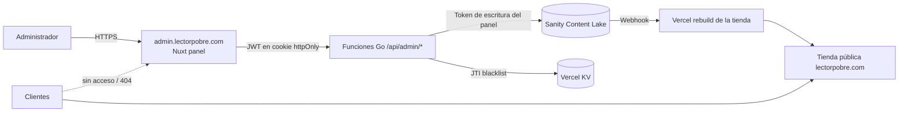
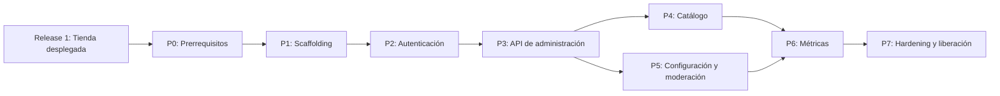

# Plan de Implementación — Panel de Control de LectorPobre (Release 2)

> **Versión:** 1.0
> **Documentos base:** [ERS_LectorPobre.md](file:///c:/Users/j_pab/Documents/dev/infoLectorPobre/ERS_LectorPobre.md) · [Arquitectura_Tecnica_Detallada_LectorPobre.md](file:///c:/Users/j_pab/Documents/dev/infoLectorPobre/Arquitectura_Tecnica_Detallada_LectorPobre.md) · [Stack_Tecnologico_LectorPobre.md](file:///c:/Users/j_pab/Documents/dev/infoLectorPobre/Stack_Tecnologico_LectorPobre.md) · [DEVELOPMENT_GUIDELINES.md](file:///c:/Users/j_pab/Documents/dev/infoLectorPobre/DEVELOPMENT_GUIDELINES.md) · [VyV_LectorPobre.md](file:///c:/Users/j_pab/Documents/dev/infoLectorPobre/VyV_LectorPobre.md) · [implementationPlan.md](file:///c:/Users/j_pab/Documents/dev/infoLectorPobre/implementationPlan.md)
> **Repositorio destino:** `c:\Users\j_pab\Documents\dev\lectorPobre` (monorepo; el panel vive como aplicación separada dentro de la carpeta `admin/`)
> **Objetivo:** Entregar un Panel de Control propio, alojado en un dominio distinto al de la tienda, que ofrezca **todas las funcionalidades de gestión que hoy ofrece Sanity Studio** (y más: métricas, stock, moderación) para comodidad del cliente, sin que los clientes de la tienda puedan acceder ni siquiera descubrir su existencia.

---

## 1. Contexto y Alcance

### 1.1 Relación con el plan de la tienda

El desarrollo se divide en dos entregas secuenciales e independientes:

| Release | Contenido | Plan | Gestión de contenido |
|---|---|---|---|
| **Release 1** | Tienda pública (Fases 0–5 y 7) | [implementationPlan.md](file:///c:/Users/j_pab/Documents/dev/lectorPobre/docs/implementationPlan.md) | Solo **Sanity Studio** |
| **Release 2** | Panel de Control propio (este plan) | `panelControlImplementacion.md` | Panel propio **+** Sanity Studio como respaldo |

> [!IMPORTANT]
> **Prerrequisito de inicio:** las 7 fases activas del plan de la tienda deben estar terminadas y la tienda desplegada en producción. Este plan **no modifica** la tienda: la tienda nunca enlaza ni referencia al panel.

### 1.2 Qué incluye el Panel de Control

| Módulo | Descripción | Requisitos ERS |
|---|---|---|
| Autenticación | Login, logout con invalidación real, sesión protegida | RF-08, RF-09, RF-10 |
| Productos | Crear, editar, eliminar, publicar/despublicar, orden | RF-11, RF-13 |
| Imágenes | Subir, reemplazar, eliminar y asignar imagen principal/galería | RF-12 |
| Stock | Vista y edición rápida de existencias, alertas de bajo stock | RF-14 |
| Categorías | CRUD de categorías y asignación | RF-13 (ampliado) |
| Configuración global | Paleta (RF-15), variantes visuales (RF-16), WhatsApp (RF-17), redes sociales (RF-05), sinónimos de búsqueda | RF-15, RF-16, RF-17, RF-05 |
| Moderación | Aprobar/rechazar/eliminar comentarios y calificaciones | RF-06, RF-07 |
| Métricas y gráficas | Productos más vistos, comentarios, calificaciones, stock, resumen de tráfico | RF-14 (ampliado) / RNF-06 |

### 1.3 Fuera de alcance

- Pagos, carrito con cobro, usuarios finales con cuenta (RNF-01 se mantiene).
- Sustituir la base de datos: **Sanity sigue siendo el almacén de datos**; el panel solo la edita mediante API con token de escritura.

---

## 2. Resumen Ejecutivo — Fases del Panel

| Fase | Nombre | Alcance | Entregables clave |
|---|---|---|---|
| P0 | Prerrequisitos y aislamiento | Dominio, proyecto Vercel, tokens | Subdominio `admin.`, proyecto Vercel separado, token Sanity exclusivo del panel |
| P1 | Scaffolding del panel | App `admin/`, layout, CI | Nuxt (SPA/SSR sin SSG público), `pnpm-workspace`, CI, `noindex` |
| P2 | Autenticación y seguridad de acceso | RF-08, RF-09, RF-10 | Login bcrypt+JWT, cookie httpOnly, logout con JTI en KV, middleware, bloqueo por intentos |
| P3 | API de administración (Go) | Proxy seguro hacia Sanity | `/api/admin/*` con validación de JWT en cada función, capa de mutaciones |
| P4 | Gestión de catálogo | Productos, categorías, imágenes, stock | CRUD completo, subida de imágenes, edición rápida de stock |
| P5 | Configuración global y moderación | Paleta, variantes, redes, comentarios | Formularios de configuración, bandeja de moderación |
| P6 | Métricas y gráficas | Dashboard | Gráficas y KPIs desde Sanity y analítica |
| P7 | Hardening, pruebas y liberación | Seguridad, V&V, despliegue | Checklist de seguridad, pruebas E2E, release, documentación para el cliente |

---

## 3. Decisiones Tomadas

| Decisión | Resolución | Impacto |
|---|---|---|
| Ubicación | **Mismo repositorio (monorepo), proyecto Vercel separado**, carpeta `admin/` | Reutiliza tipos, utilidades y esquemas sin duplicar repos; despliegue y secretos independientes |
| Dominio | Subdominio propio (p. ej. `admin.lectorpobre.com`) o dominio distinto | Aislamiento de origen, cookies y CORS; no se enlaza desde la tienda |
| Almacén de datos | Sanity (dataset `production`) vía API de mutaciones | Sin migración de datos; Studio sigue funcionando como respaldo |
| Token de Sanity | Token de escritura **exclusivo del panel**, distinto al de la tienda (que solo escribe comentarios/calificaciones) | Principio de mínimo privilegio; se revoca de forma independiente |
| Autenticación | Hash **bcrypt** en variable de entorno + **JWT** corto (8 h) en cookie `httpOnly`/`Secure`/`SameSite=Strict` | Sin base de datos de usuarios; compatible con serverless |
| Logout (RF-09) | **Invalidación real** mediante lista negra de JTI en Vercel KV con TTL = expiración | Cumple el criterio de aceptación; el token robado deja de ser válido |
| Validación | **Server-side en cada** función `/api/admin/*` (el middleware de Nuxt es solo UX) | Seguridad no depende del cliente |
| Aislamiento ante clientes | Sin enlaces ni código del panel en el bundle de la tienda, `noindex`, `robots.txt` sin pistas, respuesta **404** a no autenticados | Los clientes no pueden descubrir la ruta |
| Reflejo en la tienda | Cada mutación dispara el webhook de rebuild existente (Fase 4 de la tienda) | La tienda se actualiza en < 5 min |
| Gráficas | Librería ligera (p. ej. Chart.js vía `vue-chartjs`) | Sin dependencias pesadas; carga solo en el panel |
| V&V | Se **reutiliza** [VyV_LectorPobre.md](file:///c:/Users/j_pab/Documents/dev/lectorPobre/docs/VyV_LectorPobre.md) y se extiende con IDs `PC-*` | Una sola fuente de reglas de verificación |

> [!NOTE]
> Los archivos stub de la Fase 1 de la tienda (`api/auth/login.go`, `api/auth/logout/logout.go`, `pages/admin/login.vue`, `layouts/admin.vue`, `middleware/auth.ts`) y las variables `ADMIN_PASSWORD_HASH` / `ADMIN_JWT_SECRET` del `.env.example` son los marcadores reservados para este plan. En la fase P1 se decide si se **migran** a `admin/` (recomendado) o se reutilizan; en ningún caso quedan referenciados desde la tienda.

---

## 4. Arquitectura del Panel



Estructura propuesta dentro del monorepo:

```text
lectorPobre/
├── admin/                    # App Nuxt del Panel de Control (proyecto Vercel propio)
│   ├── pages/                # login, dashboard, productos, categorías, stock, moderación, configuración
│   ├── layouts/              # admin.vue
│   ├── middleware/           # auth.ts (UX), 404 para no autenticados
│   ├── components/           # tablas, formularios, gráficas
│   ├── composables/          # useAdminApi, useAuth, useMetrics
│   └── tests/
├── admin-api/                # Funciones Go /api/admin/* y /api/auth/*
│   ├── auth/                 # login, logout, middleware JWT
│   ├── productos/ categorias/ imagenes/ stock/ config/ moderacion/ metricas/
│   └── pkg/                  # sanity client, jwt, kv, cors, ratelimit
├── sanity/                   # Esquemas compartidos (sin cambios)
└── pnpm-workspace.yaml       # Agrega admin/ y admin-api/
```

---

## Fase P0 — Prerrequisitos y Aislamiento

**Objetivo:** Preparar la infraestructura aislada antes de escribir código.

**Satisface:** RNF-04 (seguridad) · ERS tema abierto de protección de acceso

### P0.1 Acciones manuales

1. Definir el dominio/subdominio del panel y configurarlo en DNS.
2. Crear un **segundo proyecto en Vercel** apuntando al mismo repositorio con *Root Directory* `admin/`.
3. Crear en Sanity un **token de escritura nuevo** (rol Editor) exclusivo del panel.
4. Crear una base **Vercel KV** (o Upstash Redis) para la lista negra de JTI y el contador de intentos.
5. Generar secretos: hash bcrypt de la contraseña (costo ≥ 12) y `ADMIN_JWT_SECRET` de ≥ 32 bytes aleatorios.

### P0.2 Variables de entorno del proyecto del panel

| Variable | Ambiente | Valor |
|---|---|---|
| `NUXT_PUBLIC_SANITY_PROJECT_ID` | All | ID del proyecto Sanity |
| `NUXT_PUBLIC_SANITY_DATASET` | Production / Preview | `production` / `staging` |
| `SANITY_ADMIN_WRITE_TOKEN` | All | Token de escritura exclusivo del panel |
| `ADMIN_USER` | All | Nombre de usuario del administrador |
| `ADMIN_PASSWORD_HASH` | All | Hash bcrypt |
| `ADMIN_JWT_SECRET` | All | Secreto del JWT |
| `KV_REST_API_URL` / `KV_REST_API_TOKEN` | All | Vercel KV |
| `STORE_REBUILD_HOOK_URL` | Production | Deploy Hook de la tienda |
| `ALLOWED_ORIGIN` | Production | `https://admin.lectorpobre.com` |

### P0.3 Verificación

- [ ] Subdominio resuelve y sirve HTTPS válido
- [ ] Proyecto Vercel del panel separado del de la tienda
- [ ] Token del panel distinto al de la tienda; ninguno aparece en el repositorio
- [ ] KV accesible desde una función de prueba

---

## Fase P1 — Scaffolding del Panel

**Objetivo:** Crear la aplicación del panel, su CI y sus convenciones.

**Satisface:** RNF-04 · DEVELOPMENT_GUIDELINES

### P1.1 Tareas

1. Crear `admin/` con Nuxt 3 + TypeScript + Tailwind, reutilizando `tailwind.config.ts` y los tipos de `types/sanity.ts` (vía alias de workspace).
2. Actualizar `pnpm-workspace.yaml` con `admin/` y `admin-api/`.
3. Decidir el destino de los stubs de la Fase 1 de la tienda y retirarlos del `ignore` de `nuxt.config.ts` solo si permanecen en el proyecto de la tienda (ver [Solucion_Error_Vite_EPIPE_Optimizacion_Watcher.md](file:///c:/Users/j_pab/Documents/dev/lectorPobre/docs/Solucion_Error_Vite_EPIPE_Optimizacion_Watcher.md)).
4. Cabeceras globales: `X-Robots-Tag: noindex, nofollow`, CSP estricta, `Referrer-Policy: no-referrer`.
5. `robots.txt` del panel con `Disallow: /` y **sin** mencionar rutas.
6. GitHub Actions: lint, typecheck, pruebas unitarias del panel; Preview de Vercel por PR.

### P1.2 Verificación

- [ ] `pnpm --filter admin dev` levanta el panel en un puerto distinto a la tienda
- [ ] Build del panel sin errores y sin importar código de la tienda pública
- [ ] El bundle de la tienda **no contiene** ninguna referencia al panel (`grep` de CI)
- [ ] CI del panel en verde
- [ ] Commit: `feat(admin): scaffold control panel app with isolated deployment`

---

## Fase P2 — Autenticación y Seguridad de Acceso

**Objetivo:** Implementar el acceso protegido al panel.

**Satisface:** RF-08, RF-09, RF-10 · RNF-04

### P2.1 Login (RF-08) — `POST /api/auth/login`

1. Recibe `{ usuario, password }`.
2. Compara contra `ADMIN_USER` y `ADMIN_PASSWORD_HASH` con `bcrypt.CompareHashAndPassword` (comparación en tiempo constante, mismo tiempo de respuesta si el usuario no existe).
3. Genera JWT (HS256) con `jti`, `sub`, `exp` = 8 h, firmado con `ADMIN_JWT_SECRET`.
4. Lo entrega en **cookie** `httpOnly; Secure; SameSite=Strict; Path=/`.
5. Error: `{ ok: false, error: "credenciales inválidas" }` genérico, **sin revelar si el usuario existe**.
6. **Bloqueo por intentos:** tras 5 fallos por IP/ventana de 15 min responde 429 (contador en KV).

### P2.2 Logout (RF-09) — `POST /api/auth/logout`

Inserta el `jti` en KV con TTL igual al tiempo restante del token y borra la cookie. Toda petición posterior con ese token es rechazada (401).

### P2.3 Middleware (RF-10)

- **Nuxt (UX):** redirige a `/login` si no hay sesión.
- **Go (seguridad real):** `RequireAdmin` valida firma, expiración y lista negra en **cada** función `/api/admin/*`.
- **Ocultamiento:** las rutas protegidas responden **404** (no 401/redirect revelador) a visitantes sin cookie válida; solo `/login` es visible y no se indexa.

### P2.4 Tests (Modelo en V)

| Sección | Tests | Origen |
|---|---|---|
| P2.1 login | ST-18, ST-19, PC-UT-01 (credenciales válidas → JWT), PC-UT-02 (error genérico), PC-UT-03 (bloqueo por intentos) | VyV §5.6 + nuevos |
| P2.2 logout | PC-UT-04 (JTI en lista negra), PC-IT-01 (token invalidado devuelve 401) | nuevos |
| P2.3 middleware | ST-20 (`/admin` sin token), ST-21 (JWT expirado), PC-SEC-01 (rutas protegidas devuelven 404 a anónimos) | VyV §5.6 + nuevos |

### P2.5 Verificación

- [ ] Login correcto emite cookie `httpOnly` y entra al panel (UAT-11)
- [ ] Credenciales incorrectas: mensaje genérico (RF-08)
- [ ] Logout invalida el token de inmediato (RF-09)
- [ ] Acceso sin sesión no revela el panel (RF-10, NF-10)
- [ ] El JWT expira a las 8 h
- [ ] Commit: `feat(auth): implement admin login/logout with JWT, KV blacklist and protected routes [RF-08, RF-09, RF-10, RNF-04]`

---

## Fase P3 — API de Administración (Go)

**Objetivo:** Capa segura que concentra todas las mutaciones hacia Sanity.

**Satisface:** RF-11 a RF-16 (base) · RNF-04

### P3.1 Tareas

1. Cliente Sanity en Go (`pkg/sanity`) que usa **solo** `SANITY_ADMIN_WRITE_TOKEN`; el token nunca se expone al navegador.
2. Validación de esquema de entrada en cada endpoint (tipos, longitudes, whitelist de campos); rechazar campos desconocidos.
3. Middleware global: CORS restringido a `ALLOWED_ORIGIN`, rate limiting, límite de tamaño de body, registro sin datos sensibles.
4. Tras cada mutación exitosa: llamar a `STORE_REBUILD_HOOK_URL` (con debounce para agrupar ediciones en lote).
5. Manejo de conflictos: usar `_rev` para concurrencia optimista y devolver 409 si cambió.

### P3.2 Endpoints

| Método | Ruta | Función |
|---|---|---|
| GET/POST | `/api/admin/productos` | Listar / crear |
| PATCH/DELETE | `/api/admin/productos/{id}` | Editar / eliminar |
| POST/DELETE | `/api/admin/imagenes` | Subir (asset Sanity) / eliminar |
| PATCH | `/api/admin/stock/{id}` | Ajustar existencias |
| GET/POST/PATCH/DELETE | `/api/admin/categorias` | CRUD de categorías |
| GET/PATCH | `/api/admin/config` | Configuración global |
| GET/PATCH/DELETE | `/api/admin/moderacion` | Comentarios y calificaciones |
| GET | `/api/admin/metricas` | Agregados para el dashboard |

### P3.3 Tests

- PC-UT-05..PC-UT-12: validación de entrada, rechazo sin JWT, rechazo con JTI en lista negra, `_rev` en conflicto.
- PC-IT-02..PC-IT-06: integración contra dataset `staging` (crear/editar/eliminar y verificar en Sanity).
- PC-SEC-02: el token de Sanity no aparece en ninguna respuesta ni log.

### P3.4 Verificación

- [ ] Todos los endpoints `/api/admin/*` devuelven 401 sin JWT válido
- [ ] CORS solo permite el origen del panel
- [ ] Mutaciones reflejadas en Sanity y disparan rebuild de la tienda (< 5 min)
- [ ] Commit: `feat(admin-api): add secured admin API layer over Sanity mutations [RF-11..RF-14, RNF-04]`

---

## Fase P4 — Gestión de Catálogo

**Objetivo:** Reemplazar en el panel las pantallas de Studio para productos, imágenes, categorías y stock.

**Satisface:** RF-11, RF-12, RF-13, RF-14

### P4.1 Pantallas

1. **Productos:** tabla con búsqueda, filtros (categoría, estado, stock) y paginación; formulario de creación/edición con validación y vista previa de cómo se verá en la tienda.
2. **Imágenes:** subida con previsualización, recorte/hotspot básico, texto alternativo obligatorio (accesibilidad), reordenar galería.
3. **Categorías:** CRUD con reordenamiento.
4. **Stock:** edición rápida en línea, indicador de bajo stock configurable, historial opcional de ajustes.
5. Confirmación explícita al eliminar y estado "borrador/publicado".

### P4.2 Tests

- PC-ST-01..PC-ST-06: flujos E2E (crear, editar, subir imagen, ajustar stock, eliminar).
- UAT-12..UAT-15 (VyV §6.1.4) se **re-validan** en el panel propio.

### P4.3 Verificación

- [ ] CRUD de productos funciona de punta a punta y se refleja en la tienda
- [ ] Imagen subida aparece optimizada en la tienda
- [ ] Stock editable y visible (RF-14)
- [ ] Equivalencia funcional con Sanity Studio verificada con una matriz comparativa
- [ ] Commit: `feat(admin): catalog management screens for products, images, categories and stock [RF-11..RF-14]`

---

## Fase P5 — Configuración Global y Moderación

**Objetivo:** Cubrir el resto de las funciones de Studio y la moderación.

**Satisface:** RF-15, RF-16, RF-17, RF-05, RF-06, RF-07

### P5.1 Pantallas

1. **Paleta (RF-15):** selector con vista previa en vivo y validación de contraste WCAG antes de guardar.
2. **Variantes visuales (RF-16):** selección entre las variantes definidas.
3. **Contacto y redes (RF-17, RF-05):** número de WhatsApp (formato validado), enlaces de redes (Instagram, Facebook, YouTube, etc.).
4. **Búsqueda:** administración de sinónimos del motor de búsqueda.
5. **Moderación:** bandeja de comentarios pendientes con aprobar/rechazar/eliminar, y vista de calificaciones.

### P5.2 Tests

- PC-ST-07..PC-ST-10: cambio de paleta y verificación en la tienda, validación de contraste, moderación de comentarios.
- PC-UT-13..PC-UT-15: validación de formatos (WhatsApp, URLs, colores).

### P5.3 Verificación

- [ ] Cambiar paleta/variante en el panel actualiza la tienda tras el rebuild
- [ ] Comentario pendiente aprobado aparece en la tienda; rechazado no
- [ ] Redes y WhatsApp validados antes de guardar
- [ ] Commit: `feat(admin): global settings and moderation modules [RF-05, RF-06, RF-07, RF-15, RF-16, RF-17]`

---

## Fase P6 — Métricas y Gráficas

**Objetivo:** Dashboard con indicadores útiles para el negocio.

**Satisface:** RF-14 (ampliado) · RNF-06

### P6.1 Indicadores

- KPIs: total de productos, productos sin stock, comentarios pendientes, calificación promedio global.
- Gráficas: calificaciones por producto, distribución de stock por categoría, comentarios por periodo, productos mejor/peor evaluados.
- Tráfico: resumen desde la API de Plausible (si se usa en la tienda; solo lectura, token propio del panel).
- Carga diferida de la librería de gráficas (solo en la ruta del dashboard).

### P6.2 Tests

- PC-UT-16..PC-UT-18: cálculo de agregados; PC-ST-11: render del dashboard con datos de prueba; accesibilidad de gráficas (alternativa textual).

### P6.3 Verificación

- [ ] Dashboard carga en < 3 s con el dataset de producción
- [ ] Cifras coinciden con los datos reales de Sanity
- [ ] Commit: `feat(admin): metrics dashboard with charts and KPIs [RF-14, RNF-06]`

---

## Fase P7 — Hardening, Pruebas y Liberación

**Objetivo:** Verificar seguridad y calidad antes de entregar al cliente.

**Satisface:** RNF-04 · todo el plan de V&V aplicable

### P7.1 Checklist de seguridad del panel

- [ ] Ningún secreto en el repositorio ni en el bundle (escaneo de CI)
- [ ] Cookies `httpOnly`/`Secure`/`SameSite=Strict`
- [ ] CSP estricta, sin `unsafe-inline` donde sea posible
- [ ] Rate limiting y bloqueo por intentos activos
- [ ] CORS restringido al origen del panel
- [ ] Rutas protegidas devuelven 404 a anónimos; `noindex` activo
- [ ] Rotación documentada de `ADMIN_JWT_SECRET` y del token de Sanity
- [ ] `pnpm audit` / `govulncheck` sin vulnerabilidades altas
- [ ] Opcional: restricción por IP o Cloudflare Access/Zero Trust delante del subdominio
- [ ] Opcional: 2FA (TOTP) como mejora futura

### P7.2 Pruebas de aceptación

- Ejecutar el subconjunto de V&V del Release 2: ST-18..ST-21, UAT-11, UAT-12..UAT-15, NF-10 y los IDs `PC-*`.
- UAT con el cliente: ciclo completo (login → editar producto → verlo en la tienda → logout).

### P7.3 Liberación

1. Desplegar el proyecto Vercel del panel en producción.
2. Entregar al cliente una guía breve de uso y el procedimiento de recuperación de contraseña (regenerar hash y actualizar la variable de entorno).
3. Mantener Sanity Studio como respaldo durante un periodo de estabilización.

### P7.4 Verificación

- [ ] Todas las pruebas del Release 2 pasan
- [ ] Checklist de seguridad completo
- [ ] Aceptación del cliente
- [ ] Commit: `feat(final): control panel hardening and release [RNF-04]`

---

## 5. Mapa de Dependencias



---

## 6. Plan de V&V (reutilización)

Se reutiliza [VyV_LectorPobre.md](file:///c:/Users/j_pab/Documents/dev/lectorPobre/docs/VyV_LectorPobre.md) como marco de verificación (Modelo en V, mismos niveles y criterios de salida).

| Fuente | IDs | Uso en el Panel |
|---|---|---|
| VyV §5.6 | ST-18, ST-19, ST-20, ST-21 | Login, error genérico, ruta protegida, JWT expirado (P2) |
| VyV §6.1.4 | UAT-11 | Acceso del administrador al panel (P2, P7) |
| VyV §6.1.4 | UAT-12..UAT-15 | Edición de contenido; se validan primero en Studio (Release 1) y se re-validan aquí (P4, P5) |
| VyV NF | NF-10 | Protección de acceso (P2, P7) |
| Nuevos (este plan) | `PC-UT-xx`, `PC-IT-xx`, `PC-ST-xx`, `PC-SEC-xx`, `PC-UAT-xx` | Cobertura específica del panel; se agregan al VyV al implementarse |

**Nota:** en el VyV, UT-GO-25 y UT-GO-26 corresponden a pruebas HMAC (webhook), no a login; las pruebas unitarias de login del panel usan los IDs `PC-UT-*`.

---

## 7. Trazabilidad RF/RNF → Fase del Panel

| Requisito | Descripción | Fase del panel |
|---|---|---|
| RF-08 | Login de administrador | **P2** |
| RF-09 | Logout con invalidación | **P2** |
| RF-10 | Panel protegido | **P2**, **P3** |
| RF-11 | Editar producto | **P4** |
| RF-12 | Modificar imagen | **P4** |
| RF-13 | Crear/eliminar productos y categorías | **P4** |
| RF-14 | Visualizar y editar stock (+ métricas) | **P4**, **P6** |
| RF-15 | Personalización de paleta | **P5** |
| RF-16 | Variantes visuales | **P5** |
| RF-17 | Enlace WhatsApp | **P5** |
| RF-05 | Redes sociales (administración) | **P5** |
| RF-06 / RF-07 | Moderación de calificaciones/comentarios | **P5** |
| RNF-04 | Seguridad del backend sin estado | **P0, P2, P3, P7** |
| RNF-06 | Analítica de tráfico (lectura) | **P6** |

---

## 8. Riesgos

| Riesgo | Mitigación |
|---|---|
| Fuga del token de escritura | Token exclusivo del panel, solo en servidor, rotación documentada |
| Fuerza bruta al login | Rate limiting + bloqueo + hash bcrypt de costo alto |
| Un solo administrador/contraseña | Documentar recuperación; evaluar usuarios múltiples y 2FA en una iteración futura |
| Divergencia con los esquemas de Sanity | Esquemas compartidos desde `sanity/`; pruebas de integración contra `staging` |
| Reconstrucciones excesivas de la tienda | Debounce de webhooks y edición por lotes |
| Los clientes descubren la ruta | Dominio separado, sin enlaces, `noindex`, 404 para anónimos, opcional Zero Trust |

---

*Última actualización: Octubre 2026 · Aplica a LectorPobre ERS v1.2*
*Este plan se ejecuta únicamente después de completar el Release 1 descrito en [implementationPlan.md](file:///c:/Users/j_pab/Documents/dev/lectorPobre/docs/implementationPlan.md).*
